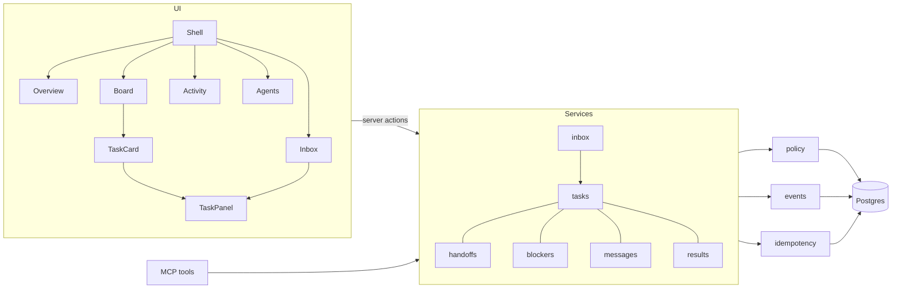

# Component map

The components, what each one is responsible for, and how they connect. Paths match `file-folder-structure.md`.

## Server modules

| Module | Responsibility | Uses | Used by |
|---|---|---|---|
| `server/auth` | Resolves a human session or an agent token into an `Actor`. Hashes tokens and updates `last_contact_at`. | db, supabase server client | layouts, actions, MCP route |
| `server/policy` | Checks workspace and project access, owner-only actions and task ownership. Pure functions with no database writes. | — | every service |
| `server/errors` | `AppError` and its codes | — | everything |
| `server/events` | Appends `activity_events` inside the caller's transaction | db | every mutating service |
| `server/idempotency` | Claims and stores `request_id` results | db | MCP-facing service calls |
| `server/workspace` | `ensureWorkspace` | db | auth callback, `requireOwner` |
| `server/projects` | Create, rename, reorder and list projects and boards | db, events, policy, `lib/schemas` | project actions, layouts |
| `server/agents` | Agent connections, grants, token rotation, revocation, profile data, and `authenticateAgent()` for bearer tokens | db, events, policy | agent actions, MCP route |
| `server/tasks` | Task CRUD, the state machine, assign, accept, reassign, reopen, moves, card badges, Stalled | db, events, policy, idempotency | actions, MCP tools, inbox |
| `server/handoffs` | Propose, respond, cancel and supersede handoffs | tasks (lock), events, policy | actions, MCP tools |
| `server/blockers` | Report, clear and resolve blockers | tasks (lock), events, policy | actions, MCP tools |
| `server/messages` | Updates, messages, replies, questions, read and answered tracking | tasks (lock), events, policy | actions, MCP tools |
| `server/results` | Submit, approve and request changes | tasks (lock), messages, events, policy | actions, MCP tools |
| `server/inbox` | The Needs your input list and its count | db | inbox page, app layout (alert count) |
| `server/activity` | The project activity feed with agent and handoff filters | db | activity page, project overview |
| `server/mcp/tools` | Registers MCP tools and maps them to services | all services, `lib/schemas` | `api/mcp/route` |

## UI components

| Component | Responsibility | Data from |
|---|---|---|
| `AppShell` (in `(app)/layout`) | Project switcher, board tabs, Agents link, Needs your input count | `workspace.list`, `inbox.count` |
| `ProjectOverview` | Task counts by stage across boards, needs-input preview, recent results and handoffs, agent activity strip (O1) | `tasks`, `inbox`, `activity`, `agents` |
| `Board` / `Column` | Five columns, drop targets limited to valid transitions | `tasks.listBoard` |
| `TaskCard` (`Card` in `board.tsx`) | Title link (opens `?task=`), assignee, review icon, `Next:` or `Result:` line, text badges, a grip **drag handle** (keyboard-draggable) and an Actions menu (Open, Move to…) as the non-drag path (O3) | props |
| `TaskPanel` | Side panel with instructions, links, messages, results, handoffs, blockers and history, plus the actions allowed in the task's current state | `tasks.getDetail` |
| `HandoffList` | From → to, status, reason, work completed, outcome (O4) | props |
| `InboxList` | Blockers, questions, reviews, stalled and agent-can't-access items, each linking to its task with an inline action (O5) | `inbox.list` |
| `ActivityFeed` | Events with actor, action and time, and agent and handoff filters | `activity.list` |
| `AgentList` / `AgentProfile` | Status, projects, last contact, waiting and active work, recent events, and the actions to change access, reconnect or disconnect | `agents.*` |
| `ConnectAgentForm` / `TokenReveal` | Choose the client, name and projects, then show the token once with setup snippets | `agents.create` |
| `AutoRefresh` | Calls `router.refresh()` every ~10 s and when the window regains focus | — |

## Relationships

