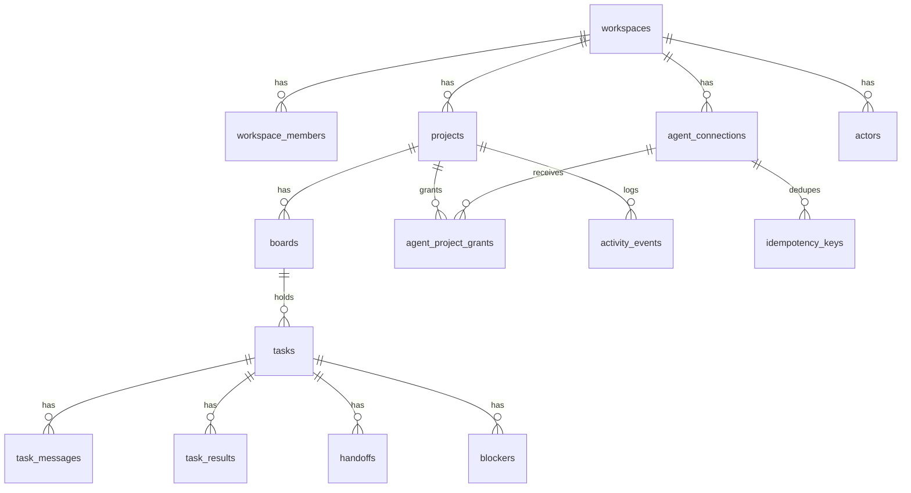

# Database schema

PostgreSQL on Supabase (D-7). Tables are defined in `src/server/db/schema.ts` (Drizzle), and migrations live in `drizzle/`. This document describes the intended first-release schema. Update it whenever a migration changes the schema.

## Conventions

- Primary keys are `uuid` with the default `gen_random_uuid()`. The exception is `activity_events`, which uses `bigint identity` because it is append-only and ordered.
- Every timestamp is `timestamptz`.
- Enums are Postgres `text` columns with a `CHECK` constraint, which is easier to migrate than `CREATE TYPE`.
- `links` columns are `jsonb` arrays of `{ "label": string, "url": string }`, validated by Zod before they are written.
- Human accounts live in Supabase's `auth.users`. The app never writes to that table; it only references `auth.users(id)`.
- RLS is enabled on every table with **no policies**. The app connects with a privileged role and enforces access in `src/server/policy.ts`, so the anon key can read nothing (D-8).

## Entity overview

## Identity

### `workspaces`
| Column | Type | Notes |
|---|---|---|
| id | uuid PK | |
| name | text not null | Defaults to "My workspace" |
| default_require_review | boolean not null default true | Pre-ticks "Require my review" on the New task form (D-32). Tasks agents create always require review (D-11). |
| created_at | timestamptz not null default now() | |

### `workspace_members`
This table keeps ownership separate from the login account, so team memberships can be added later without moving any data (`Roundabout.md` §2).

| Column | Type | Notes |
|---|---|---|
| workspace_id | uuid FK → workspaces, on delete cascade | PK part |
| user_id | uuid FK → auth.users, on delete cascade | PK part |
| role | text not null check (`'owner'`) | Only `owner` exists in the first release. Teammate roles come later. |
| created_at | timestamptz not null default now() | |

- `unique (workspace_id) where role = 'owner'`: one owner per workspace.
- `unique (user_id) where role = 'owner'`: an account owns one workspace. This makes "create the initial workspace once" idempotent (atlas diagram 01, step 03).

### `agent_connections`
Each connection is one named agent with its own identity, such as "Claude Code – laptop".

| Column | Type | Notes |
|---|---|---|
| id | uuid PK | |
| workspace_id | uuid FK → workspaces, on delete cascade | |
| name | text not null | `unique (workspace_id, lower(name)) where status <> 'revoked'` (migration 0002), so a disconnected agent frees its name |
| client | text not null check in (`'claude_code'`, `'codex'`, `'other'`) | The list grows as more clients are verified (roadmap) |
| token_hash | bytea unique null | SHA-256 of the bearer token. Null after the connection is revoked. |
| token_prefix | text null | The first 8 characters of the token, displayed so the owner can recognise it |
| status | text not null check in (`'setup'`, `'active'`, `'error'`, `'revoked'`) default `'setup'` | `setup` becomes `active` on the first authenticated call |
| last_contact_at | timestamptz null | The last successful authenticated request. This records when the agent last checked in, not whether it is available now. |
| last_error | text null | The last authentication or tool error shown to the owner. Never contains a secret. |
| created_at | timestamptz not null default now() | |
| revoked_at | timestamptz null | |
| deleted_at | timestamptz null | Set by Delete agent (D-28). Deleted agents are always revoked, hidden from every list and 404 on their page, but the row stays so results, handoffs and history keep their author. |

### `agent_project_grants`
| Column | Type | Notes |
|---|---|---|
| agent_connection_id | uuid FK → agent_connections, on delete cascade | PK part |
| project_id | uuid FK → projects, on delete cascade | PK part |
| created_at | timestamptz not null default now() | |

A grant covers every board in the project (§2). The first release has no per-action permissions, so a granted agent can use every agent tool in that project.

### `actors`
A single reference type for "who did this", whether a human or an agent. Messages, events, blockers and the requester column point here instead of each carrying two nullable foreign keys.

| Column | Type | Notes |
|---|---|---|
| id | uuid PK | |
| workspace_id | uuid FK → workspaces, on delete cascade | |
| kind | text not null check in (`'human'`, `'agent'`) | |
| user_id | uuid null FK → auth.users | Set when `kind = 'human'` |
| agent_connection_id | uuid null unique FK → agent_connections | Set when `kind = 'agent'` |

- `check ((kind = 'human') = (user_id is not null) and (kind = 'agent') = (agent_connection_id is not null))`
- `unique (workspace_id, user_id)`
- The owner's actor row is created with the workspace, and an agent's actor row is created with its connection. Actor rows are never deleted, so attribution survives a revoked agent (§3).

## Projects and boards

### `projects`
| Column | Type | Notes |
|---|---|---|
| id | uuid PK | |
| workspace_id | uuid FK → workspaces, on delete cascade | |
| name | text not null | `unique (workspace_id, lower(name))` |
| created_at | timestamptz not null default now() | |

### `boards`
| Column | Type | Notes |
|---|---|---|
| id | uuid PK | |
| project_id | uuid FK → projects, on delete cascade | |
| name | text not null | `unique (project_id, lower(name))` |
| position | int not null | Order of the board tabs |
| created_at | timestamptz not null default now() | |

- `unique (id, project_id)`: the target of the composite foreign key on `tasks`.
- A project and its first board are inserted in one transaction (atlas diagram 03, step 02).

## Tasks

### `tasks`
| Column | Type | Notes |
|---|---|---|
| id | uuid PK | |
| project_id | uuid not null | Denormalized for access checks and project-wide queries |
| board_id | uuid not null | `FK (board_id, project_id) → boards (id, project_id)`, which guarantees the board belongs to the same project |
| title | text not null | 1–200 characters |
| instructions | text not null default '' | |
| expected_result | text not null default '' | |
| links | jsonb not null default '[]' | Supporting resources |
| repository | text null | Optional context for coding tasks |
| branch | text null | |
| status | text not null check in (`'backlog'`, `'todo'`, `'in_progress'`, `'review'`, `'done'`) default `'backlog'` | The Kanban column |
| require_review | boolean not null default true | D-3 |
| assignee_agent_id | uuid null FK → agent_connections | The agent assigned to the task, or the agent that owns it once accepted |
| next_action | text null | Shown on the card. Set by agent updates or by the owner. |
| created_by_actor_id | uuid not null FK → actors | The requester |
| completed_by_actor_id | uuid null FK → actors | The agent that finished the task (review off) or the owner who approved it (review on) |
| completed_at | timestamptz null | |
| revision | int not null default 1 | Incremented on every change. Board edits send the revision they saw (optimistic concurrency). |
| last_activity_at | timestamptz not null default now() | Updated on every task event. Used to detect stalled work (D-4). |
| created_at, updated_at | timestamptz not null default now() | |

**Derived states** (computed when a task is read, never stored):

| Badge | Rule |
|---|---|
| Waiting for pickup | `status = 'todo' and assignee_agent_id is not null` |
| Handoff pending | A `handoffs` row exists with `status = 'pending'` |
| Blocked | A `blockers` row exists with `status = 'open'` (D-2) |
| Stalled | `last_activity_at < now() - interval '24 hours'` and the task is waiting for pickup, has a pending handoff, or is `in_progress`, and the task has no open blocker (D-4, D-11) |
| Agent can't access | The task is not `done`, and the assignee is `revoked` or has no grant for the task's project (D-11) |

**Indexes:** `(board_id, status)`, `(project_id, status)`, `(assignee_agent_id) where status in ('todo','in_progress')`.

### `task_messages`
These hold progress updates, directed messages, replies and questions (atlas diagram 10).

| Column | Type | Notes |
|---|---|---|
| id | uuid PK | |
| task_id | uuid FK → tasks, on delete cascade | |
| sender_actor_id | uuid not null FK → actors | Taken from the authenticated request, never from the request body |
| recipient_actor_id | uuid null FK → actors | Set for directed messages |
| parent_message_id | uuid null FK → task_messages | Set for replies |
| kind | text not null check in (`'update'`, `'message'`, `'question'`) | A `question` sent to the owner appears in Needs your input until it is answered |
| body | text not null | |
| links | jsonb not null default '[]' | |
| read_at | timestamptz null | Set the first time the recipient fetches the message. This is separate from task acceptance (§5). |
| answered_at | timestamptz null | For a `question`, set when the recipient replies |
| created_at | timestamptz not null default now() | |

Index: `(task_id, created_at)`, plus `(recipient_actor_id) where kind = 'question' and answered_at is null`.

### `task_results`
Each row is one submission. Review decisions are stored on the same row because every submission gets at most one decision.

| Column | Type | Notes |
|---|---|---|
| id | uuid PK | |
| task_id | uuid FK → tasks, on delete cascade | |
| submitted_by_agent_id | uuid not null FK → agent_connections | |
| summary | text not null | The "latest result" line on the card |
| details | text not null default '' | |
| links | jsonb not null default '[]' | Pull requests, commits, documents |
| review_status | text not null check in (`'not_required'`, `'pending'`, `'approved'`, `'changes_requested'`, `'superseded'`) | |
| reviewed_by_user_id | uuid null FK → auth.users | |
| review_comment | text null | Required when the status is `changes_requested` |
| reviewed_at | timestamptz null | |
| created_at | timestamptz not null default now() | |

`unique (task_id) where review_status = 'pending'`: a task has at most one submission waiting for review. Earlier submissions are kept, and a reassignment marks a pending one `superseded`.

### `handoffs`
| Column | Type | Notes |
|---|---|---|
| id | uuid PK | |
| task_id | uuid FK → tasks, on delete cascade | |
| from_agent_id | uuid not null FK → agent_connections | Must be the task's current owner when the handoff is proposed |
| to_agent_id | uuid not null FK → agent_connections | Must have a grant for the task's project. `check (from_agent_id <> to_agent_id)`. |
| reason | text not null | |
| work_completed | text not null | |
| next_action | text not null | |
| links | jsonb not null default '[]' | |
| status | text not null check in (`'pending'`, `'accepted'`, `'declined'`, `'cancelled'`, `'superseded'`) default `'pending'` | `superseded` is set when the owner reassigns the task or an agent is revoked |
| decline_reason | text null | |
| resolved_by_actor_id | uuid null FK → actors | |
| created_at | timestamptz not null default now() | |
| resolved_at | timestamptz null | |

`unique (task_id) where status = 'pending'`: a task has at most one pending handoff.

### `blockers`
| Column | Type | Notes |
|---|---|---|
| id | uuid PK | |
| task_id | uuid FK → tasks, on delete cascade | |
| raised_by_actor_id | uuid not null FK → actors | |
| reason | text not null | |
| question | text not null | The specific thing that needs an answer |
| needs_actor_id | uuid null FK → actors | Who must respond, when known. Null means the owner. |
| missing_resource | text null | For example "write access to github.com/acme/api" (atlas diagram 11) |
| status | text not null check in (`'open'`, `'resolved'`) default `'open'` | |
| resolution | text null | |
| resolved_by_actor_id | uuid null FK → actors | |
| created_at | timestamptz not null default now() | |
| resolved_at | timestamptz null | |

Index: `(task_id) where status = 'open'`.

## History and reliability

### `activity_events`
Append-only. Each event is written in the same transaction as the change it records (§7).

| Column | Type | Notes |
|---|---|---|
| id | bigint generated always as identity PK | |
| workspace_id | uuid not null | |
| project_id | uuid null | Null only for workspace-level events, such as an agent being connected |
| task_id | uuid null | |
| actor_id | uuid not null FK → actors | |
| type | text not null | See the event types below |
| data | jsonb not null default '{}' | Small, display-ready details (`from_status`, `to_status`, `handoff_id`, `to_agent_id`, …). Never holds secrets or full task text. |
| created_at | timestamptz not null default now() | |

Indexes: `(project_id, created_at desc)`, `(task_id, created_at)`, and `(project_id, actor_id, created_at desc)` for the per-agent filter.

**Event types:**
- Task: `task.created`, `task.edited`, `task.moved_board`, `task.status_changed`
- Assignment: `task.assigned`, `task.accepted`, `task.reassigned`, `task.reopened`
- Communication: `message.posted`, `blocker.reported`, `blocker.resolved`
- Handoff: `handoff.proposed`, `handoff.accepted`, `handoff.declined`, `handoff.cancelled`, `handoff.superseded`
- Results: `result.submitted`, `review.approved`, `review.changes_requested`, `task.completed`
- Agents and projects: `agent.connected`, `agent.access_changed`, `agent.revoked`, `agent.token_rotated`, `project.created`, `board.created`

### `idempotency_keys`
Lets an agent retry a write safely after a timeout (atlas diagrams 07 and 10).

| Column | Type | Notes |
|---|---|---|
| agent_connection_id | uuid FK → agent_connections, on delete cascade | PK part |
| key | text | PK part. The `request_id` sent by the client. |
| operation | text not null | The tool name. Reusing a key for a different tool is rejected. |
| response | jsonb not null | The stored tool result, replayed when the same key is sent again |
| created_at | timestamptz not null default now() | Keys older than 7 days can be deleted. `ponytail:` no cleanup job in the first release; add one if the table grows. |

The key is inserted in the same transaction as the write it protects. A concurrent duplicate hits the primary-key conflict, and that request replays the stored response.

## Needs your input query (D-4, atlas diagram 16)

These items are computed for a project when the page loads. No inbox table exists.

1. Open blockers.
2. Unanswered `question` messages sent to the owner's actor.
3. `task_results` rows with `review_status = 'pending'`.
4. Stalled tasks.
5. Unfinished tasks whose assignee has been revoked or has lost access to the task's project.

In-app alerts are the count of these items, shown in the navigation and refreshed with the board.
