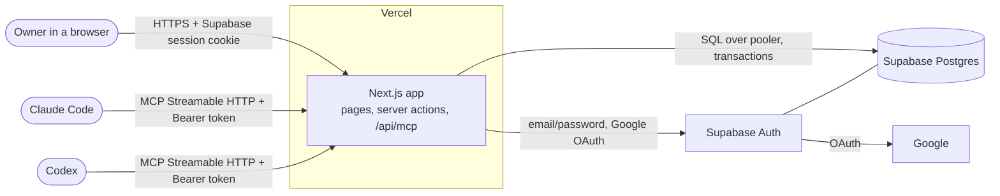
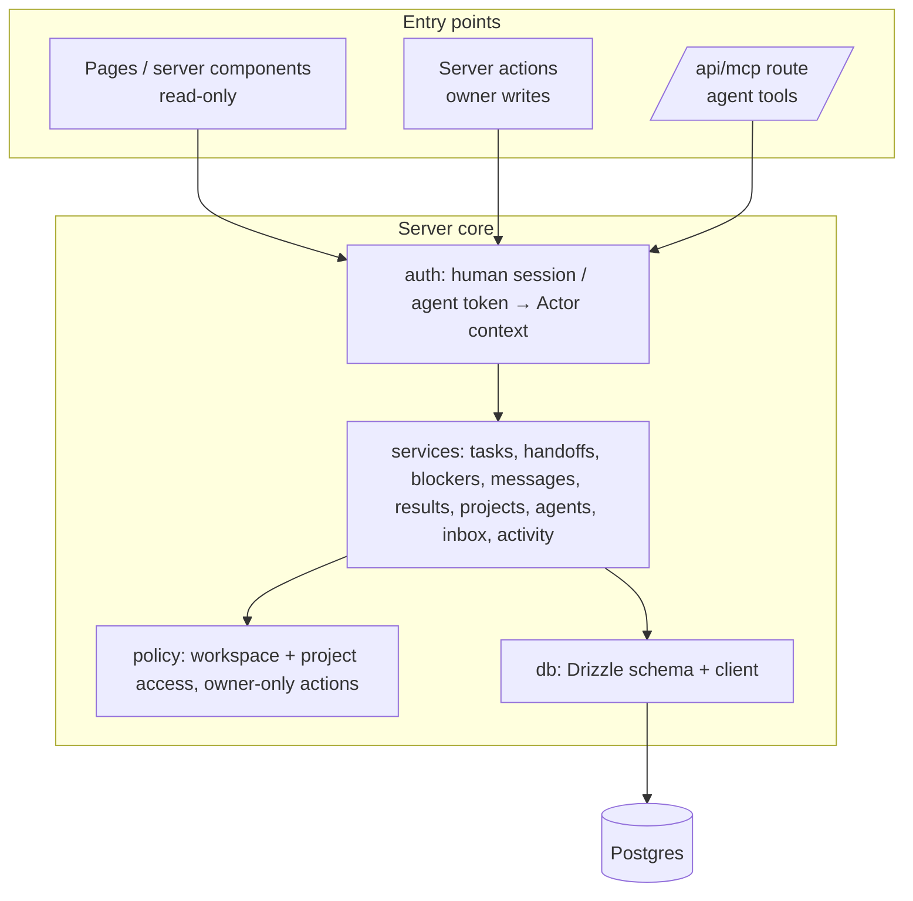

# System architecture

## Context

There is **one deployable app**. The web UI and the MCP endpoint are two entry points into the same server code (D-8).

## Boundaries

| Boundary | Who crosses it | How it is authenticated | What is trusted after it |
|---|---|---|---|
| Browser → app | Owner | Supabase Auth session cookie, checked on the server with `supabase.auth.getUser()` | `user_id`, which resolves to the workspace and the owner's actor |
| Agent → `/api/mcp` | Agent client | `Authorization: Bearer rbt_…`. The token's SHA-256 hash is looked up in `agent_connections`, and the connection must not be `revoked`. | `agent_connection_id`, which resolves to the agent's actor and its project grants |
| App → Postgres | Server code only | `DATABASE_URL` (privileged role) | Everything. The database is never exposed to clients, and RLS with no policies blocks the anon key. |
| App → Supabase Auth | Server and browser | Supabase publishable (anon) key | Auth flows only. No application data is read through Supabase's REST API. |

## Layers inside the app

- Entry points only parse input with Zod, resolve the actor and call a service function. **They contain no business rules.**
- **Services** are the only code that writes to the database. Each write runs in one transaction that:
  1. locks the task,
  2. runs the policy and state checks,
  3. applies the change,
  4. appends an `activity_events` row,
  5. increments `revision` and `last_activity_at`,
  6. stores the idempotency key when there is one.
- **Policy** is a small set of pure checks used by every service. This is how the board and the agents share one rule set (atlas diagram 07).

## Data flows

**An agent change appearing on the board.** The agent calls an MCP tool, which runs a service transaction that commits. On its next refresh (about 10 s, or when the window regains focus), the owner's board re-runs its server-component query and shows the committed state. The actor, state and result are identical because both sides read the same rows.

**An owner action reaching an agent.** The owner's server action commits. An agent sees it the next time it calls `list_assignments` or `get_task`. Nothing is pushed to agents in the first release, because pickup happens when the agent is opened (§1).

## Deployment

- **Vercel project:** Next.js, Node runtime, functions in the region closest to the Supabase project.
- **Supabase project (Free):** Postgres and Auth, with Google enabled. Allowed redirect URLs are the production URL plus `http://localhost:3000`.
- **Migrations:** run `drizzle-kit migrate` against `DIRECT_URL` from a developer machine or a CI step. They never run at app startup.
- **Local development:** `npm run db:start` (Supabase in Docker) for Postgres and Auth, then `npm run dev`. Agents connect to `http://localhost:3000/api/mcp`.

## Scaling and limits (first release)

- Supabase **pauses Free-plan projects after about a week with no activity**. A paused project makes the app and the MCP endpoint fail until someone restores it in the dashboard. This is acceptable during development. Move to a paid plan, or keep the project active, before anyone relies on it.
- Free-tier Supabase has connection and size limits. The transaction pooler on port 6543 keeps serverless connections bounded.
- MCP runs stateless: every request is authenticated on its own and no session lives in memory, so it works on serverless functions.
- `ponytail:` refresh polling is O(owners × tabs). Move to Supabase Realtime or Server-Sent Events if many owners keep boards open.
